# Схема Бази Даних ЄДР (Unified State Register Database Schema)

Документація структури даних, реляційних зв'язків та опису полів бази даних **Єдиного державного реєстру юридичних осіб, фізичних осіб-підприємців та громадських формувань (ЄДР)** у СУБД PostgreSQL.

---

## 📐 ER-Діаграма Реляційних Зв'язків (Mermaid)

```mermaid
erDiagram
    uo_subjects ||--o{ founders : "має засновників (subject_type='uo')"
    uo_subjects ||--o{ beneficiaries : "має бенефіціарів (subject_type='uo')"
    uo_subjects ||--o{ signers : "має керівників (subject_type='uo')"
    uo_subjects ||--o{ members : "має членів органів управління"
    uo_subjects ||--o{ branches : "має відокремлені підрозділи"
    uo_subjects ||--o{ predecessors : "має попередників (subject_type='uo')"
    uo_subjects ||--o{ assignees : "має правонаступників"
    uo_subjects ||--o{ termination_started : "стан припинення (subject_type='uo')"
    uo_subjects ||--o{ bankruptcy_readjustment : "процедура банкрутства"
    uo_subjects ||--o{ exchange_data : "облік у ДПС (subject_type='uo')"

    fop_subjects ||--o{ exchange_data : "облік у ДПС (subject_type='fop')"

    fsu_subjects ||--o{ founders : "має засновника (subject_type='fsu')"
    fsu_subjects ||--o{ beneficiaries : "має бенефіціарів (subject_type='fsu')"
    fsu_subjects ||--o{ signers : "має керівників (subject_type='fsu')"
    fsu_subjects ||--o{ predecessors : "має попередників (subject_type='fsu')"
    fsu_subjects ||--o{ termination_started : "стан припинення (subject_type='fsu')"
    fsu_subjects ||--o{ exchange_data : "облік у ДПС (subject_type='fsu')"

    uo_subjects {
        bigint id PK
        text record UK "Унікальний ідентифікатор запису ЄДР"
        text name "Повне найменування"
        text short_name "Скорочене найменування"
        text opf "Організаційно-правова форма"
        text edrpou "Код ЄДРПОУ (8 цифр)"
        text stan "Стан діяльності"
    }

    fop_subjects {
        bigint id PK
        text record UK "Унікальний ідентифікатор запису ЄДР"
        text name "ПІБ Фізичної Особи-Підприємця"
        text stan "Стан діяльності"
        text farmer "Ознака сімейного фермерського господарства"
    }

    fsu_subjects {
        bigint id PK
        text record UK "Унікальний ідентифікатор запису ЄДР"
        text name "Найменування відокремленого підрозділу"
        text edrpou "Код ЄДРПОУ підрозділу"
        text type_branch "Вид відокремленого підрозділу"
    }

    founders {
        bigint id PK
        text subject_type "uo або fsu"
        text subject_record FK "Посилання на record сутності"
        text founder_info "ПІБ / Назва засновника, розмір частки"
    }

    beneficiaries {
        bigint id PK
        text subject_type "uo або fsu"
        text subject_record FK "Посилання на record сутності"
        text beneficiary_info "ПІБ бенефіціара, країна, % частки"
    }

    signers {
        bigint id PK
        text subject_type "uo або fsu"
        text subject_record FK "Посилання на record сутності"
        text signer_info "ПІБ керівника / підписанта, роль, обмеження"
    }

    branches {
        bigint id PK
        text subject_record FK "Посилання на record UO"
        text code "Код ЄДРПОУ філії"
        text name "Найменування філії"
    }

    exchange_data {
        bigint id PK
        text subject_type "uo, fop, fsu або branch"
        text subject_record FK "Посилання на record сутності"
        text tax_payer_type "Відомчий реєстр ДПС"
        text start_date "Дата взяття на облік"
    }
```



---

## 🗂️ Опис Таблиць та Полів Бази Даних

### 1. `uo_subjects` — Юридичні Особи (Legal Entities)
Головна таблиця юридичних осіб України (~2.01 млн записів).

| Поле | Тип | Опис | Індекс |
|------|-----|------|--------|
| `id` | `BIGSERIAL` | Внутрішній первинний ключ | `PRIMARY KEY` |
| `record` | `TEXT` | Унікальний номер запису суб'єкта в ЄДР | `UNIQUE` |
| `name` | `TEXT` | Повне найменування юридичної особи | `idx_uo_name` |
| `short_name` | `TEXT` | Скорочене найменування | — |
| `opf` | `TEXT` | Організаційно-правова форма (напр., ТОВ, ПАТ, ПП) | — |
| `edrpou` | `TEXT` | Код ЄДРПОУ (8-значний ідентифікаційний код) | `idx_uo_edrpou` |
| `stan` | `TEXT` | Стан діяльності (зареєстровано, припинено, в процесі припинення) | `idx_uo_stan` |
| `founding_document_num` | `TEXT` | Цифровий код модельного статуту | — |
| `executive_power_name` | `TEXT` | Орган виконавчої влади, до сфери якого належить ДП | — |
| `executive_power_code` | `TEXT` | Код ЄДРПОУ органу виконавчої влади | — |
| `purpose` | `TEXT` | Мета діяльності (для громадських формувань) | — |
| `superior_management` | `TEXT` | Назви органів управління (напр., Загальні збори, Директор) | — |
| `authorized_capital` | `TEXT` | Розмір статутного/складеного капіталу (у грн) | — |
| `statute` | `TEXT` | Відомості про статут / установчі документи | — |
| `registration` | `TEXT` | Дата та номер реєстраційної дії створення | — |
| `managing_paper` | `TEXT` | Дані про розпорядчий акт створення | — |
| `terminated_info` | `TEXT` | Дата/номер запису та підстава припинення | — |
| `termination_cancel_info` | `TEXT` | Дата/номер запису відміни припинення | — |

---

### 2. `fop_subjects` — Фізичні Особи-Підприємці (Individual Entrepreneurs)
Реєстр ФОП України (~6.98 млн записів).

| Поле | Тип | Опис | Індекс |
|------|-----|------|--------|
| `id` | `BIGSERIAL` | Внутрішній первинний ключ | `PRIMARY KEY` |
| `record` | `TEXT` | Унікальний номер запису в ЄДР | `UNIQUE` |
| `name` | `TEXT` | Прізвище, ім'я та по батькові ФОП | `idx_fop_name` |
| `stan` | `TEXT` | Стан діяльності (зареєстровано, припинено) | `idx_fop_stan` |
| `farmer` | `TEXT` | Ознака створення сімейного фермерського господарства | — |
| `estate_manager` | `TEXT` | ПІБ управителя майна ФОП | — |
| `registration` | `TEXT` | Дата та номер реєстраційної дії | — |
| `terminated_info` | `TEXT` | Дата/номер запису та підстава припинення діяльності | — |
| `termination_cancel_info` | `TEXT` | Відомості про скасування припинення | — |

---

### 3. `fsu_subjects` — Відокремлені Підрозділи Іноземних ЮО (Foreign Separate Units)
Відокремлені підрозділи іноземних компаній та представництва в Україні (879 записів).

| Поле | Тип | Опис | Індекс |
|------|-----|------|--------|
| `id` | `BIGSERIAL` | Первинний ключ | `PRIMARY KEY` |
| `record` | `TEXT` | Унікальний номер запису ЄДР | `UNIQUE` |
| `name` | `TEXT` | Найменування підрозділу | `idx_fsu_name` |
| `short_name` | `TEXT` | Скорочене найменування | — |
| `type_subject` | `TEXT` | Вид суб'єкта | — |
| `type_branch` | `TEXT` | Вид відокремленого підрозділу (Представництво, Філія) | — |
| `edrpou` | `TEXT` | Код ЄДРПОУ в Україні | `idx_fsu_edrpou` |
| `stan` | `TEXT` | Стан діяльності | `idx_fsu_stan` |
| `founding_document` | `TEXT` | Вид установчого документа (Положення тощо) | — |
| `registration` | `TEXT` | Дата акредитації/реєстрації | — |
| `terminated_info` | `TEXT` | Інформація про припинення | — |
| `termination_cancel_info` | `TEXT` | Інформація про відміну припинення | — |

---

### 4. `founders` — Засновники та Учасники
Відомості про засновників юридичних осіб та іноземних підрозділів (1:N зв'язок).

| Поле | Тип | Опис | Індекс |
|------|-----|------|--------|
| `id` | `BIGSERIAL` | Первинний ключ | `PRIMARY KEY` |
| `subject_type` | `TEXT` | Тип батьківської сутності (`uo` або `fsu`) | — |
| `subject_record` | `TEXT` | Посилання на `record` з `uo_subjects` або `fsu_subjects` | `idx_founders_record` |
| `founder_info` | `TEXT` | ПІБ / Назва засновника, код ЄДРПОУ, країна, розмір частки | — |

---

### 5. `beneficiaries` — Кінцеві Бенефіціарні Власники (КБВ)
Інформація про бенефіціарних власників компаній (1:N зв'язок).

| Поле | Тип | Опис | Індекс |
|------|-----|------|--------|
| `id` | `BIGSERIAL` | Первинний ключ | `PRIMARY KEY` |
| `subject_type` | `TEXT` | Тип батьківської сутності (`uo` або `fsu`) | — |
| `subject_record` | `TEXT` | Посилання на `record` з `uo_subjects` або `fsu_subjects` | `idx_beneficiaries_record` |
| `beneficiary_info` | `TEXT` | ПІБ бенефіціара, країна громадянства, тип впливу, % частки | — |

---

### 6. `signers` — Керівники та Підписанти
Відомості про керівників осіб, які мають право вчиняти дії від імені сутності (1:N зв'язок).

| Поле | Тип | Опис | Індекс |
|------|-----|------|--------|
| `id` | `BIGSERIAL` | Первинний ключ | `PRIMARY KEY` |
| `subject_type` | `TEXT` | Тип сутності (`uo` або `fsu`) | — |
| `subject_record` | `TEXT` | Посилання на `record` сутності | `idx_signers_record` |
| `signer_info` | `TEXT` | ПІБ керівника, дата призначення, роль, наявні обмеження | — |

---

### 7. `branches` — Відокремлені Підрозділи ЮО
Філії та представництва українських юридичних осіб (1:N зв'язок з `uo_subjects`).

| Поле | Тип | Опис | Індекс |
|------|-----|------|--------|
| `id` | `BIGSERIAL` | Первинний ключ | `PRIMARY KEY` |
| `subject_record` | `TEXT` | Посилання на `record` материнської компанії з `uo_subjects` | `idx_branches_record` |
| `code` | `TEXT` | Код ЄДРПОУ філії/підрозділу | `idx_branches_code` |
| `name` | `TEXT` | Найменування філії | — |
| `signer` | `TEXT` | Відомості про керівника філії | — |
| `create_date` | `TEXT` | Дата створення філії | — |

---

### 8. `exchange_data` — Інформаційний Обмін з ДПС
Дані про взяття та зняття з обліку в органах Державної податкової служби України.

| Поле | Тип | Опис | Індекс |
|------|-----|------|--------|
| `id` | `BIGSERIAL` | Первинний ключ | `PRIMARY KEY` |
| `subject_type` | `TEXT` | Тип суб'єкта (`uo`, `fop`, `fsu`, `branch`) | — |
| `subject_record` | `TEXT` | Посилання на `record` батьківської сутності | `idx_exchange_record` |
| `branch_code` | `TEXT` | Код філії (якщо облікові дані стосуються філії) | — |
| `tax_payer_type` | `TEXT` | Відомчий реєстр ДПС (напр., Реєстр платників податків, ЄСВ) | — |
| `start_date` | `TEXT` | Дата взяття на облік | — |
| `start_num` | `TEXT` | Номер запису про взяття на облік | — |
| `end_date` | `TEXT` | Дата зняття з обліку | — |
| `end_num` | `TEXT` | Номер запису про зняття з обліку | — |

---

### 9. `members`, `predecessors`, `assignees`, `termination_started`, `bankruptcy_readjustment`

- **`members`**: Відомості про членів керівних органів ЮО (ПІБ, посада).
- **`predecessors`**: Юридичні особи - попередники (найменування, код ЄДРПОУ).
- **`assignees`**: Юридичні особи - правонаступники (найменування, код ЄДРПОУ).
- **`termination_started`**: Дані про перебування сутності в процесі припинення (підстава, ліквідатор, строк вимог кредиторів).
- **`bankruptcy_readjustment`**: Дані про провадження у справі про банкрутство та санацію (розпорядник майна, підстава).

---

## 🔗 Приклади РЕЛЯЦІЙНИХ SQL-Запитів

### Отримання Повної Картки Юридичної Особи з Засновниками та Бенефіціарами

```sql
SELECT 
    s.edrpou,
    s.name AS company_name,
    s.opf,
    s.stan,
    f.founder_info,
    b.beneficiary_info,
    sig.signer_info
FROM uo_subjects s
LEFT JOIN founders f ON f.subject_record = s.record AND f.subject_type = 'uo'
LEFT JOIN beneficiaries b ON b.subject_record = s.record AND b.subject_type = 'uo'
LEFT JOIN signers sig ON sig.subject_record = s.record AND sig.subject_type = 'uo'
WHERE s.edrpou = '14359609';
```

### Перевірка Податкового Обліку ФОП у ДПС

```sql
SELECT 
    f.name AS fop_name,
    f.stan,
    ex.tax_payer_type,
    ex.start_date,
    ex.end_date
FROM fop_subjects f
JOIN exchange_data ex ON ex.subject_record = f.record AND ex.subject_type = 'fop'
WHERE f.name LIKE 'ПЕТРЕНКО ІВАН%'
LIMIT 10;
```
